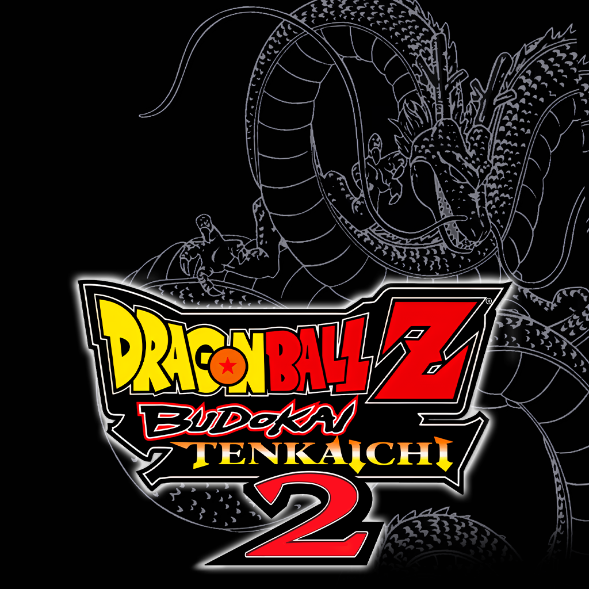

<p align="center"></p>

# BT2-Recomp

Port nativo a PC de *Dragon Ball Z: Budokai Tenkaichi 2* (PS2), **por recompilación + C nativo**.

> [!IMPORTANT]
> **No es un emulador.** El juego no corre sobre PCSX2 ni interpreta la ISO en tiempo real: es un ejecutable
> x86-64 con el GS, el VU1, el audio, la memory card y la entrada reimplementados.
>
> **No es un decompilado completo todavía.** La base es [PS2Recomp](https://github.com/ran-j/PS2Recomp)
> (recompilación estática de MIPS a C++) más C nativo portado a mano. El **decomp matching byte a byte está en
> proceso y va a tardar**: hoy el C del juego es *equivalente* (hace lo mismo que el original), no idéntico.
> Todavía salen de PS2Recomp unas **633 funciones** de relleno de biblioteca/SDK, que se van reemplazando de a
> poco.
>
> **Esto es un WIP y los bugs son esperados.** Andan los menús, Dueling, Ultimate Battle, Dragon Adventure, las
> peleas por equipos, la memory card, los videos y el audio. Todavía faltan el build de Windows y varios arreglos
> de traducción/renderer (ver [Estado](#estado--limitaciones-conocidas)). Si algo se rompe, es parte del proceso.

## Requisitos

- **Tu propia copia del juego.** Edición NTSC-U (`SLUS_214.41` / `SLUS-21441`). Opcional: edición PAL
  (`SLES-54164` / `SLES_541.64`) para los textos y las texturas de menú multiidioma.
- **Linux x86-64.** Probado en Arch Linux. Windows está en progreso, todavía no soportado.
- **GPU con OpenGL 3.3 core o Vulkan.** También hay un renderer por software de referencia.
- **Para compilar:** clang, Python 3.11+, SDL3, ffmpeg (libav*), zstd, ninja/cmake, pkg-config y el toolchain
  MIPS del decomp. El detalle está en [Build](#build).

## Cómo se juega hoy

La **app de setup (F7)** está en `setup/`: ventana SDL3 + ImGui y el mismo instalador en modo consola. Lee tu
propia ISO9660 sin montarla ni usar `7z`, verifica el SHA-1 de `SLUS_214.41` y de `BIN/DBZP.BIN`, copia
~2,98 GB a `gamedata/` y escribe el marcador `.installed`.

```sh
# 1) compilar la app una vez (no toca el build del juego)
./setup/build.sh

# 2) instalar desde tu ISO (tu archivo, no se sube al repo)
./setup/build/bt2-setup
#    o por consola:
./setup/build/bt2-setup --install "/ruta/a/Dragon Ball Z - Budokai Tenkaichi 2 (USA).iso"

# 3) jugar (desde la raíz del repo)
./port/build/full/bt2full
```

La ventana permite **arrastrar la ISO**, elegir el destino (por defecto `gamedata/`), agregar la **ISO PAL**
opcional para el multiidioma, ver el progreso por archivo, **cancelar** y **retomar** (saltea lo ya copiado), y
al terminar ofrece **Jugar**, que lanza `port/build/full/bt2full` desde la raíz con `BT2_DATA`/`BT2_ELF` ya
apuntando a la carpeta instalada. El modo consola tiene `--check` (revisa la ISO y/o la instalación), `--list`
(muestra el disco), `--play` y `--force`; sale con 0 si todo bien, 1 si hay error y 3 si el programa del disco no
es el de la edición USA. El detalle está en `setup/ENTREGA.md`.

`setup/install.py` sigue estando como alternativa de fase 1 y comparte el mismo formato de datos y de marcador.
La vía manual `7z x -ogamedata "<iso>"` ya no hace falta.

El binario busca `gamedata/`, `bt2_settings.txt` y `bt3_pipelines.txt` en el directorio actual: ejecutalo desde
la raíz del repo. Si instalaste en otra carpeta, apuntá `BT2_DATA` (y `BT2_ELF`) a ella; la app de setup lo hace
sola al presionar Jugar. Para el multiidioma se copia `DATA/ZS2EU_1.AFS` del disco PAL (ver [Idiomas](#idiomas)).

En la copia de pruebas se usa un `jugar.sh [gl|vulkan]` que agrega logs y volcado F9 (el video es opt-in:
`BT2_RECORD=/ruta.mp4 ./jugar.sh`); ese lanzador todavía no está incluido en este repo. Para compilar desde cero, ver [Build](#build).

## Build

### Linux (soportado)

Requisitos: clang (probado con 23.1.4), Python 3.11+, SDL3, ffmpeg (libavformat/libavcodec/libswscale/libavutil),
zstd, ninja/cmake y pkg-config. La parte de decomp necesita además splat y ee-gcc 2.96 + binutils MIPS (el
ps2-decomp-kit los deja en `tools/`; ver `game.toml` y `port/tools/`).

**Necesitás tu copia del ELF en `disc/SLUS_214.41`.** Las tablas del enlace (`build/SLUS_214.41.ld`, símbolos,
`link.ld`) se generan de ahí. **No hacen falta la ISO ni los AFS para compilar**; si tenés la ISO, `configure.py`
puede extraer el ELF solo.

```sh
# base decomp/recomp: parte el ELF, genera build.ninja y las tablas
python3 configure.py && ninja

# port nativo: compila el C del juego a x86-64 y enlaza
python3 port/tools/build_full.py --jobs 4
python3 port/tools/link_full.py
```

La salida es `port/build/full/bt2full`. `build_full.py` deja `port/build/gen/full/report.csv` con el estado de
cada unidad; `link_full.py` informa errores y símbolos faltantes.

El enlace usa el relleno de **PS2Recomp**: hace falta el checkout en `third_party/PS2Recomp` (commit `2c5fbb9` +
la serie de parches del kit) y haber corrido `python3 scripts/recomp.py` para generar `port/build/recomp/`. Ese
código es GPL y no se versiona en este repo; cuando el relleno llegue a cero, deja de ser necesario.

Para builds pesados, `scripts/capped.sh` corre un paso con tope de memoria (systemd-run), así el build no se lleva
puesto el escritorio:

```sh
scripts/capped.sh 12G python3 port/tools/build_full.py --jobs 4
scripts/capped.sh 8G python3 port/tools/link_full.py
```

### Windows (en progreso, no soportado todavía)

La vía planificada es **mingw-w64 cruzado desde Linux**, igual que Tenkaichi3Decomp. **MSVC no** es viable: el
enlace usa ~6.200 símbolos absolutos y la RAM de la PS2 mapeada en la dirección 0 del proceso. Los bloqueantes
conocidos están en `port/full/mem.c` (`mmap` en 0, `ucontext`, `sigaction`). Plan y fases:
[`staging/F10_build_windows.md`](staging/F10_build_windows.md).

### Otras plataformas

No planificadas por ahora. El port es x86-64 solamente.

### Reproducibilidad entre equipos

- **PS2Recomp pinneado:** commit `2c5fbb9` + la serie de parches `ps2recomp-0001..0009` del ps2-decomp-kit
  (rama `bt2`).
- **clang 23.x** (probado con 23.1.4). Para comparar binarios entre máquinas hacen falta las mismas versiones de
  clang, SDL3 y ffmpeg.
- **`bt3_pipelines.txt` va versionado:** son los overrides de pipelines del renderer; se leen del directorio
  actual o de `$BT3_PIPELINES`.
- **Sin rutas absolutas de una máquina concreta en el build:** los scripts resuelven todo desde la raíz del repo
  (no hay rutas del tipo `/home/rexx`). Los datos del juego se buscan en `gamedata/` o en `$BT2_DATA`; el
  directorio actual (`$PWD`) es el que usa el binario para `bt2_settings.txt` y `bt3_pipelines.txt`.
- **Qué se verifica:** el decomp termina con `CHECK` byte-idéntico contra el ELF; el port deja `report.csv` por
  unidad y el enlace reporta los faltantes. El `link.ld` se genera en cada máquina.
- **Los datos del juego no se versionan:** cada uno pone su ISO/ELF. El repo no trae binarios del juego.

## Features

- **Widescreen 16:9 por defecto.** El 3D corrige la proyección (el FOV horizontal se abre) y los menús, textos,
  HUD y películas se estiran al ancho. El efecto lateral esperado es que los textos/HUD queden ~33 % más anchos.
  Se cambia en la ventana F1 o con `BT2_ASPECT=4:3` / `BT2_WIDE=0`.
- **Renderizador GS propio:** OpenGL 3.3 core y Vulkan (backend SDL3 GPU), más un GS por software de referencia
  para diagnóstico.
- **Autoguardado:** el juego pregunta si guardar/sobrescribir y el port contesta que sí. Está encendido por
  defecto; se apaga con `BT2_AUTOSAVE=0` o `autosave=0` en `bt2_settings.txt`.
- **Saltar intro:** saltea los logos y el opening del arranque (unos 2 minutos), sin tocar el título, el menú ni
  el attract. Encendido por defecto; `BT2_SKIP_INTRO=0` o `skip_intro=0` muestra la intro original.
- **Textos editables:** `bt2_texto.txt` (base/inglés) o `textos/bt2_texto.<lang>.txt`, con líneas `MSG=texto` y
  `\n` para el salto de línea. `$BT2_TEXTO` permite apuntar a otro archivo. No toca el AFS, la ISO ni el save.
- **Ventana de ajustes (F1):** vídeo (resolución interna 1x–8x, aspecto, fullscreen, display, pack de texturas),
  efectos (outline, tintes, glow, blur), audio (música/efectos), controles (teclas y mando) y cheats (el
  "Unlock everything" que dejó el propio juego). Se guarda en `bt2_settings.txt`.
- **F11:** pantalla completa.

### Idiomas

El port separa **voces** de **texto y texturas**:

- **Voces:** siempre las del juego, EN/JP. Se eligen en la pantalla del propio juego (bit del save, `+0x1008`);
  el port **no dobla nada** y no cambia las voces.
- **Textos + texturas de menú:** salen del **disco PAL** (`SLES-54164`), no de una traducción hecha a mano.
  Copiá `DATA/ZS2EU_1.AFS` del disco PAL a `gamedata/DATA/` (o usá
  `setup/build/bt2-setup --install <USA.iso> --eu-iso <PAL.iso>`, o `setup/install.py` con las mismas opciones)
  y elegí el idioma con `idioma=0..4` en
  `bt2_settings.txt` o con `BT2_IDIOMA`:
  `0=EN`, `1=ES`, `2=FR`, `3=DE`, `4=IT` (también acepta `en`, `es`, `fr`, `de`, `it`). El cambio pide reiniciar.
- **Sin ISO PAL:** el juego funciona en inglés y se pueden pisar textos con `bt2_texto.txt` o
  `textos/bt2_texto.<lang>.txt`.
- Los overrides propios se aplican **encima** de la tabla del idioma; no reemplazan las voces.

## Controles por defecto

| Acción | Teclado | Mando (SDL3) |
|---|---|---|
| Arriba / abajo / izquierda / derecha | Flechas | D-pad |
| Cross | `K` | Botón sur (A) |
| Círculo | `L` | Botón este (B) |
| Cuadrado | `J` | Botón oeste (X) |
| Triángulo | `I` | Botón norte (Y) |
| L1 | `U` | LB |
| R1 | `O` | RB |
| L2 | `7` | LT |
| R2 | `9` | RT |
| L3 | — | Clic del stick izquierdo |
| R3 | — | Clic del stick derecho |
| START | `Enter` | Start |
| SELECT | `Shift` derecho | Back |
| Stick izquierdo | `W` / `A` / `S` / `D` | Stick izquierdo |
| Stick derecho | — | Stick derecho |
| Ventana de ajustes | `F1` | — |
| Pantalla completa | `F11` | — |

El jugador 2 comparte teclado y mando con el jugador 1 por defecto. Con `BT3_PAD_SEPARATE=1` usa controles
propios; los bindings se cambian desde la pestaña Controls de F1.

## Estado del soporte

| Plataforma / función | Estado |
|---|---|
| Linux x86-64 | ✅ soportado |
| Windows | ❌ en progreso (plan en `staging/F10_build_windows.md`) |
| Multijugador / split-screen | ⚠️ implementado, sin verificar a fondo |
| Multiidioma | ✅ con ISO PAL |
| Instalador / setup app | ✅ nativo, GUI + consola (`setup/`) |
| Vulkan | ✅ backend SDL3 GPU |
| Renderer por software | ✅ referencia, sin widescreen |

## Estado / limitaciones conocidas

El detalle vivo está en [`docs/ESTADO.md`](docs/ESTADO.md). Resumen:

- **Abiertos conocidos:** B30 (la niebla por profundidad del pase `dclut` en GL usa mal la escala de z), la
  niebla/fade del borde del mundo (F1 de features) y el build de Windows.
- **Pendiente de confirmar:** el ultimate de Roshi (B27), el UB de la 2.ª pelea (B19) y algunos arreglos que ya
  están en el C.
- **En proceso:** el decomp matching byte a byte y el reemplazo de las ~633 funciones de relleno de PS2Recomp
  por C propio/`plat_*` (más el instalador).
- **Bugs esperados por ser WIP.** Si encontrás uno, sirve mucho un log del lanzador de pruebas (`logs/vivo/`) y
  un volcado con F9.

## Legal

Este repositorio **no incluye datos del juego**: ni ISO, ni ELF, ni AFS, ni SFD, ni texturas. Cada persona aporta
su propia copia legal.

El código y la documentación propios se publican bajo **CC0 1.0 Universal** (ver [`LICENSE`](LICENSE)): se pueden
usar, modificar y redistribuir sin condiciones.

Las marcas, personajes, arte, música y demás assets de *Dragon Ball Z: Budokai Tenkaichi 2* pertenecen a sus
dueños (Bandai Namco, Toei Animation y quienes correspondan). Este es un proyecto **no oficial**, sin relación
con ellos ni con Sony/PlayStation. El logo de portada es arte promocional del juego y se usa sólo para
identificar el proyecto.

Los componentes de terceros conservan su licencia: ImGui (MIT), xxhash (BSD-2-Clause) y PS2Recomp (GPL-3.0, que
no se distribuye en este repositorio).

## Créditos

- [PS2Recomp](https://github.com/ran-j/PS2Recomp), de ran-j: recompilador estático MIPS → C++ y runtime base.
- [Tenkaichi3Decomp](https://github.com/z3xox/Tenkaichi3Decomp): referencia de port (estructura `plat_*`,
  renderer GS, VU1, entrada).
- Herramientas del decomp: [splat](https://github.com/ethteck/splat),
  [m2c](https://github.com/matt-kempster/m2c) y
  [decomp-permuter](https://github.com/simonlindholm/decomp-permuter).
